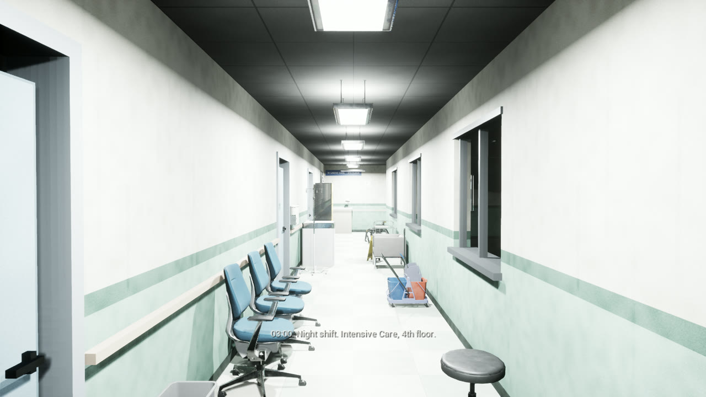
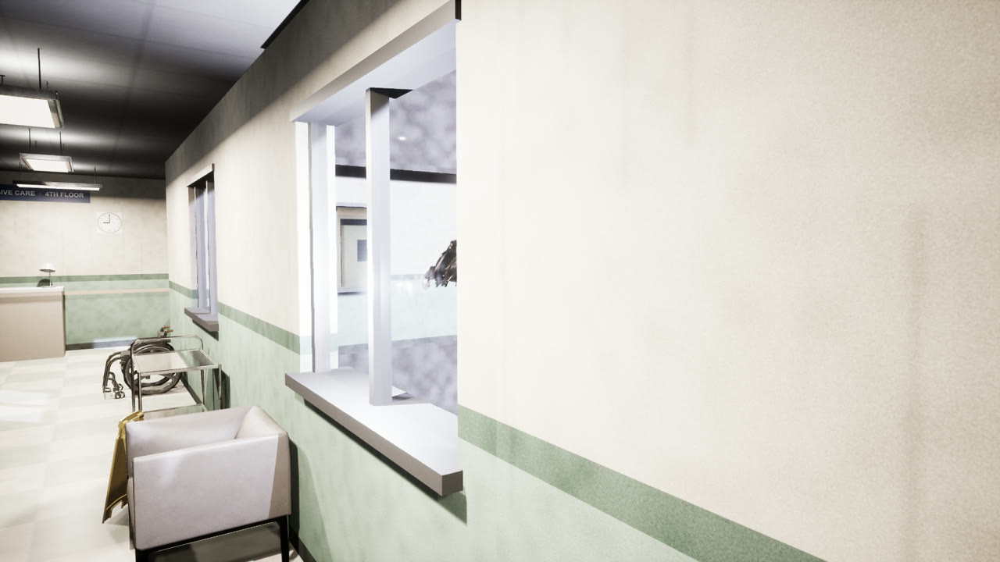
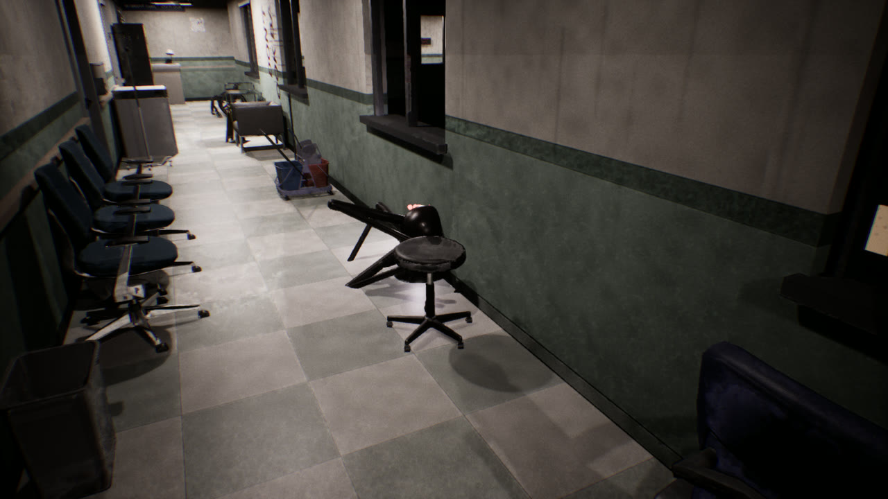
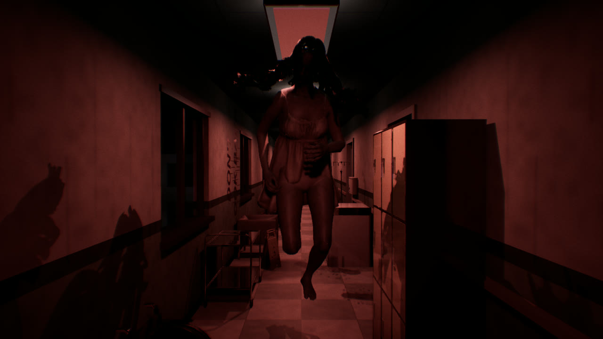

# Night Shift

A first-person looping-corridor horror game for Windows, made with **Unreal Engine 5.8 + C++**.

3:00 AM, Intensive Care, 4th floor. You walk the L-shaped corridor and step into the stairwell at the end of the ward.
The door closes behind you, and you are back at the start of the same corridor. Each loop changes a little:
almost nothing at first, then things get worse. Survive 12 loops until dawn.

## ⬇️ [Download for Windows — NightShift_Windows.zip (531 MB)](https://github.com/nxtr1609/night-shift/releases/download/v0.1/NightShift_Windows.zip)

**Tải bản chơi cho Windows:** bấm link trên. (Nút xanh "Code → Download ZIP" chỉ tải mã nguồn, không chơi được.)

🎬 **Trailer:** [NightShift_Trailer.mp4](https://github.com/nxtr1609/night-shift/releases/download/v0.1/NightShift_Trailer.mp4)

*Tiếng Việt ở bên dưới.*

## Download and play

1. Download **[NightShift_Windows.zip](https://github.com/nxtr1609/night-shift/releases/download/v0.1/NightShift_Windows.zip)** (or open **[Releases](../../releases)**).
2. Unzip it anywhere and run **`NightShift.exe`**. No install needed.

Windows may show a "Windows protected your PC" warning because the game is not signed: click **More info → Run anyway**.
If the game does not start, install the Visual C++ runtime included in the zip: `Engine\Extras\Redist\en-us\vc_redist.x64.exe`.

Needs Windows 10/11 64-bit and a DirectX 12 graphics card (GTX 1060 / RX 580 or better; RTX 2060+ recommended). Headphones recommended.

## Controls

| Key | Action |
|---|---|
| W A S D | Walk |
| Mouse | Look |
| Shift (hold) | Run |
| E | Open doors, answer the phone (it flashes red and shows a big **E**) |
| Left mouse (hold) | Grab and drag objects (chairs, carts, stretchers…), release to drop |
| Esc | Pause |

Progress is saved after every loop: choose **Continue** in the main menu.
One rule from loop 8 on: **don't look back.**

## Build from source

The `Content/` folder (imported models, sounds, textures) is not in this repository: it is large and includes Unreal sample content.
To rebuild it you need Unreal Engine 5.8, Visual Studio 2022 (C++), Blender and Python:

1. `scripts/tai_simready.py` downloads the SimReady models, `scripts/usd_sang_glb.py` (Blender) converts them to GLB.
2. Download "Ghost Girl Animated" from Sketchfab and run `scripts/lam_bong_ma.py` (Blender).
3. `scripts/tao_am_thanh.py` (Audio Studio MCP) and `scripts/tao_giong_noi.py` (Piper) make the sounds; `Tools/ve_anh.py` draws the textures.
4. In an empty Unreal project with the Third Person template content, run `Tools/tao_tai_nguyen.py` then `Tools/chuyen_hoat_anh.py` with `UnrealEditor-Cmd.exe -run=pythonscript`.

Note: the MSVC compiler fails on paths with non-ASCII characters, so keep the project in an ASCII-only path.
Code and comments are in Vietnamese.

## Credits

See [CREDITS.md](CREDITS.md).

---

# Tiếng Việt

Game kinh dị góc nhìn thứ nhất về hành lang lặp, làm bằng **Unreal Engine 5.8 + C++**. Chữ trong game bằng tiếng Anh.

03:00 sáng, khoa Hồi Sức tầng 4. Bạn đi hết hành lang chữ L rồi bước vào buồng cầu thang cuối khoa.
Cánh cửa đóng sau lưng, và bạn lại đứng ở đầu hành lang ấy. Mỗi vòng thay đổi một chút, lúc đầu gần như không có gì,
rồi mọi thứ tệ dần. Qua 12 vòng thì trời sáng.

**Cách chơi:**
1. Tải **[NightShift_Windows.zip](https://github.com/nxtr1609/night-shift/releases/download/v0.1/NightShift_Windows.zip)**.
2. Giải nén ra đâu cũng được, bấm đúp **`NightShift.exe`**. Không cần cài đặt.
3. Nếu Windows báo "Windows protected your PC": bấm **More info → Run anyway**.

**Phím:** WASD đi · chuột nhìn · giữ Shift chạy · **E** mở cửa / nghe điện thoại · **giữ chuột trái** kéo đồ vật · Esc tạm dừng.
Tiến trình tự lưu sau mỗi vòng (chọn **Continue** ở menu). Từ vòng 8: **đừng quay lại nhìn**.

Cần Windows 10/11 64-bit, card đồ họa hỗ trợ DirectX 12. Nên đeo tai nghe.

Ghi công: [CREDITS.md](CREDITS.md).
